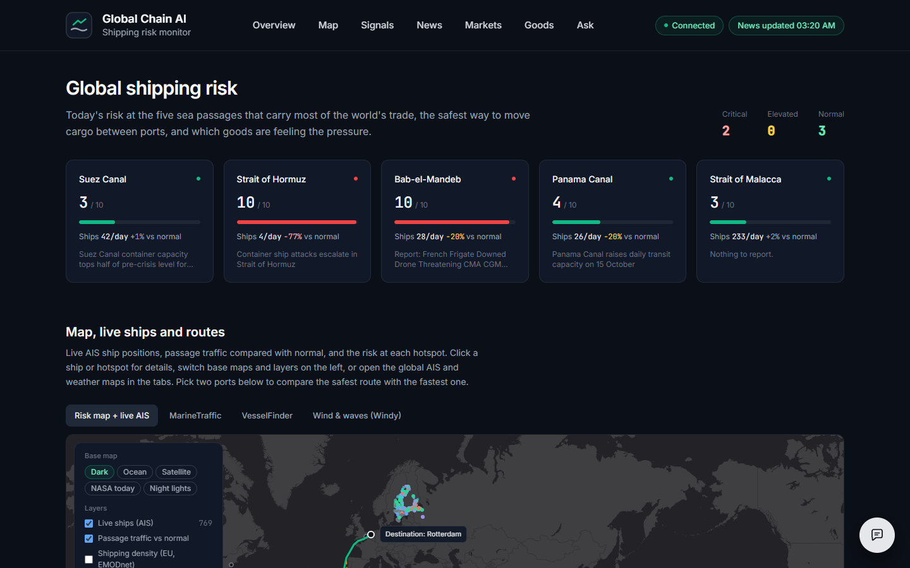
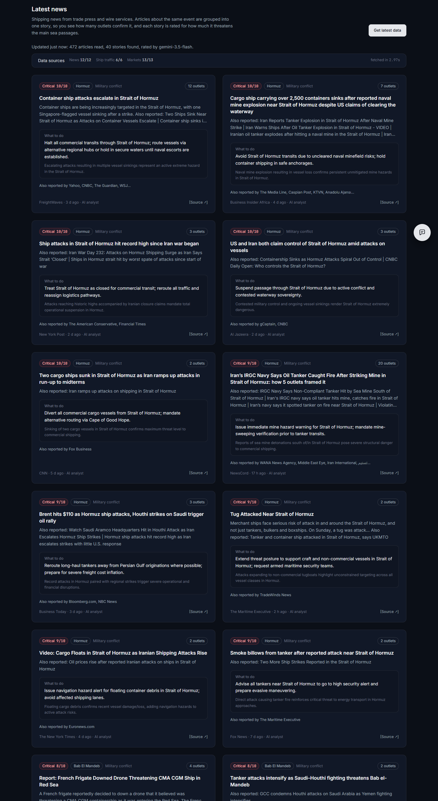
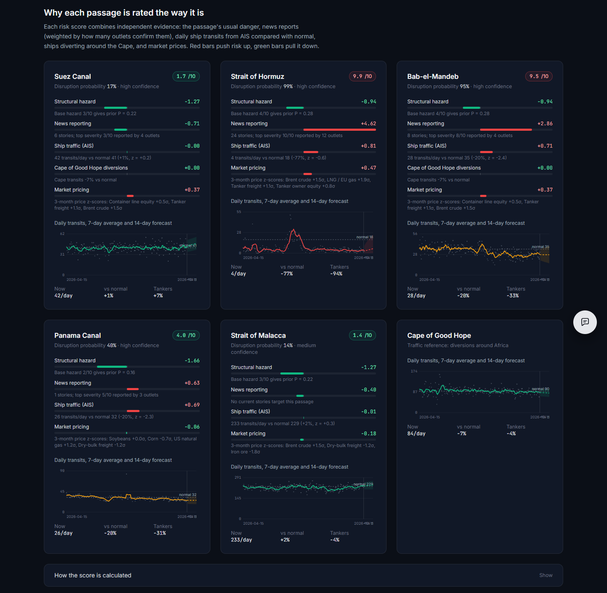
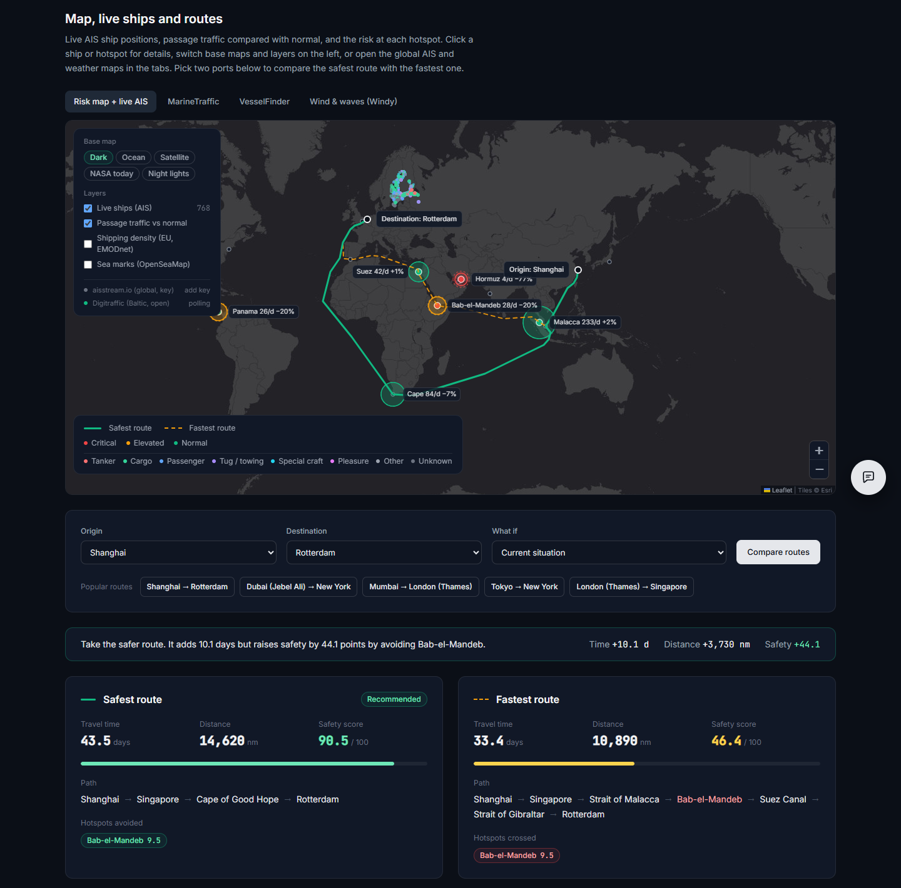
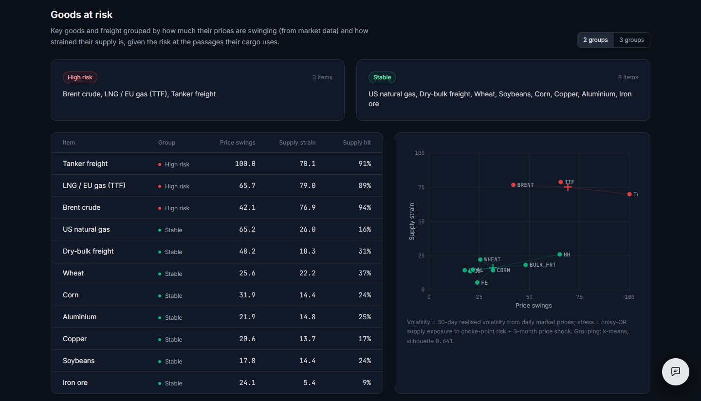
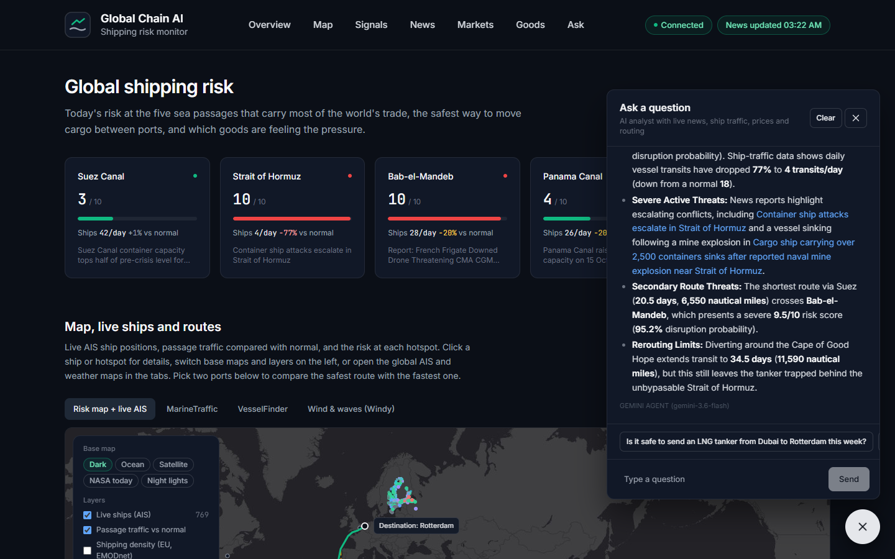
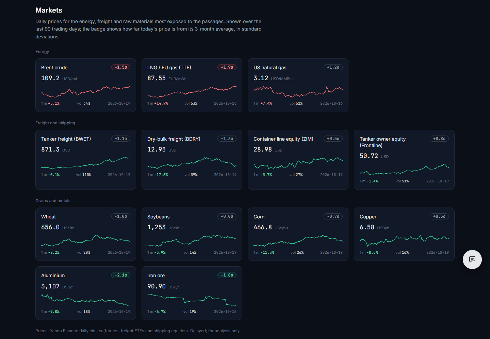
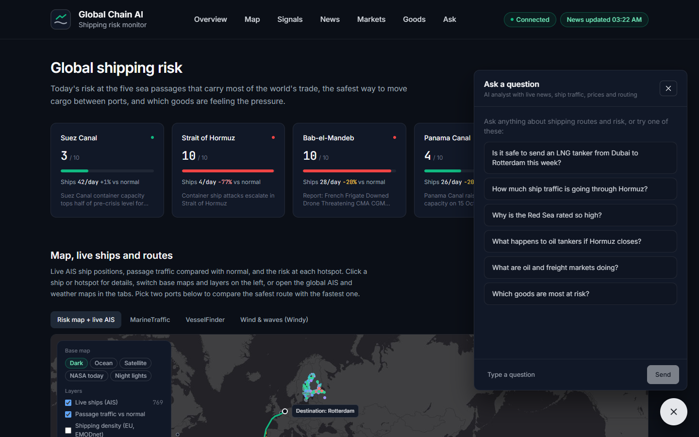
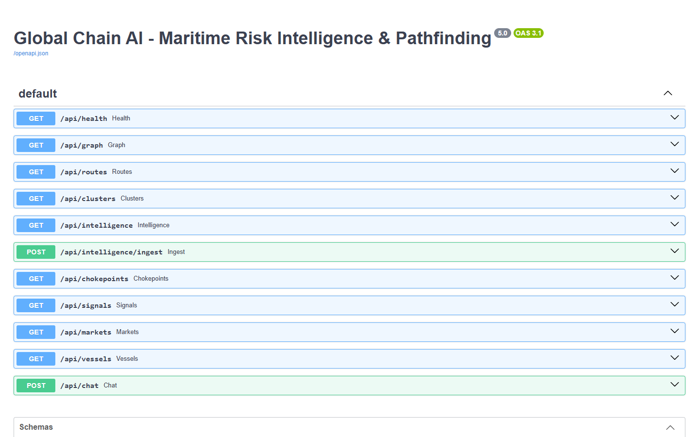

<div align="center">

# 🌊 Global Chain AI

### What happens to the world's cargo when a strait closes?

**An AI agent that watches the five sea passages carrying most of global trade, reads the news and live ship traffic,
rates the danger at each one, and finds the safest route for your cargo — then explains every number.**




</div>

---

## Why it's interesting

Suez, Hormuz, Bab-el-Mandeb, Panama, Malacca. When one of them gets dangerous, tankers re-route around Africa,
freight rates jump and wheat, oil and LNG prices move. Global Chain AI turns that chaos into three answers:

1. **How risky is each passage right now?** (0–10, with the news and traffic evidence behind it)
2. **What is the safest route from port A to port B** — and how much longer is it than the fastest one?
3. **Which goods are feeling the pressure?**

It is built as a textbook **rational agent** (sensors → reasoning → actions) and stacks *nine* AI techniques into one
working product. Pull the plug on the LLM and it keeps running on its rule engine.

## Screenshots

| Live threat events from the news | Bayesian evidence fusion per passage |
|---|---|
|  |  |
| **Safest vs fastest route (A\* search)** | **Goods at risk (K-Means)** |
|  |  |
| **Copilot: ask in plain English** | **Market signals** |
|  |  |

<details>
<summary>More: overview after a live refresh, Copilot panel, API docs</summary>

| After live ingestion | Copilot | Swagger API docs |
|---|---|---|
|  |  |  |

</details>

## The AI inside

| # | Technique | What it does here |
|---|---|---|
| 1 | **LLM (Google Gemini)** | Reads the top stories and returns a strict-JSON threat rating: passage, event type, severity 1–10, recommended action |
| 2 | **Rule-based expert system** | 16 forward-chaining rules rate the news when Gemini is unavailable, with an explainable rule trace |
| 3 | **A\* search** | Routes over a 16-node sea graph; cost = sailing days + canal wait + risk penalty; great-circle heuristic, checked admissible at start-up |
| 4 | **K-Means (k-means++, silhouette)** | Groups commodities into *High risk / Watch / Stable* |
| 5 | **TF-IDF + cosine similarity** | Merges the same event reported by different outlets; retrieval memory (RAG) for the Copilot |
| 6 | **Time-series analysis** | Median/MAD anomaly detection on ship traffic + Holt exponential-smoothing 14-day forecast |
| 7 | **Naive-Bayes evidence fusion** | Combines prior hazard, news, traffic drop, Cape re-routing and market moves into a disruption probability |
| 8 | **Noisy-OR model** | Chance a commodity's supply is hit by any passage |
| 9 | **Tool-using agent** | The Copilot calls internal tools (routes, risk, news search) and answers only with numbers from the platform |

**Sensors:** 12 news feeds (trade press + Google News), IMF PortWatch transit counts, Yahoo Finance prices and live AIS
ship positions (aisstream.io, Digitraffic).

```
 news · ship traffic · prices ──► clean, rank, cluster ──► Gemini or rule engine rates threats
                                                                │
                     Bayesian fusion → risk 0–10 per passage ◄──┘
                                │
          A* re-plans routes · K-Means re-groups goods · Copilot answers ──► dashboard
```

## Quick start

```bash
python -m venv .venv
.venv\Scripts\activate          # macOS/Linux: source .venv/bin/activate
pip install -r requirements.txt
copy .env.example .env          # optional (macOS/Linux: cp): add a free Gemini key and an aisstream.io key
python backend.py
```

Open **http://localhost:8000** for the dashboard and **http://localhost:8000/docs** for the API.
No key? It runs in rule-engine mode with a curated baseline dataset until you press **Get latest data**.

| Variable | Needed? | Purpose |
|---|---|---|
| `GEMINI_API_KEY` | optional | LLM threat rating and Copilot prose ([free key](https://aistudio.google.com/apikey)) |
| `AISSTREAM_API_KEY` | optional | Live global ship positions ([aisstream.io](https://aisstream.io), sign in with GitHub) |
| `GEMINI_MODEL`, `GEMINI_FALLBACK_MODELS` | optional | Override the models |
| `GEMINI_MAX_RPM` | optional | Local cap on Gemini calls per minute (default 8) |
| `PORT` | optional | Server port (default 8000) |

## Project structure

```
backend.py        FastAPI server: ingestion, threat rating, A*, K-Means, Copilot, REST API
ai_models.py      TF-IDF, story clustering, anomaly detection, Holt forecast, Bayesian fusion, Noisy-OR
data_sources.py   News feeds, IMF PortWatch traffic, market prices
ais_live.py       Live AIS ship positions (aisstream.io / Digitraffic)
index.html        Single-page dashboard (React 18 + Leaflet + Tailwind from CDNs)
docs/screenshots  The images above
```

## API

| Endpoint | What it returns |
|---|---|
| `GET /api/health` | LLM status, quota and data freshness |
| `GET /api/chokepoints` | Risk 0–10 per passage with its evidence |
| `GET /api/routes` | Safest vs fastest route between two ports: ETA, distance, safety index |
| `GET /api/clusters` | Commodity risk groups |
| `GET /api/signals` · `/api/markets` · `/api/vessels` | Traffic anomalies, prices, live ships |
| `POST /api/intelligence/ingest` | Pull the latest news and re-rate everything |
| `POST /api/chat` | Copilot answer |

Full, interactive reference at `/docs` once the server is running.

## Troubleshooting

| Symptom | Fix |
|---|---|
| `GEMINI_API_KEY not found … fallback mode` | Put `.env` next to `backend.py` with a real key (or carry on: the rule engine covers it) |
| LLM status stays `COOLDOWN` | Free-tier quota hit; wait, or lower `GEMINI_MAX_RPM` |
| Ingestion returns `BASELINE` | No feed was reachable; check your connection |
| Dashboard is blank | The CDN scripts were blocked; check the browser console |
| Port 8000 in use | Set `PORT=8001` in `.env` |

## Extend it

- **New news source:** add an entry to `FEEDS` in `data_sources.py`.
- **New port or passage:** add it to `NODES` and `EDGE_WAYPOINTS` in `backend.py` (the start-up check flags any edge shorter than its great-circle distance).
- **New expert rule:** append a `(name, conditions, conclusions)` tuple to `RULES`.
- **Change the risk/time trade-off:** `RISK_ALPHA`, `RISK_BETA`, `SAFETY_DECAY`, `SHIP_SPEED_KNOTS` at the top of `backend.py`.

---

<sub>Educational and research project. Risk scores, routes and commodity indicators are model estimates — not for real navigation, security or trading decisions.</sub>
